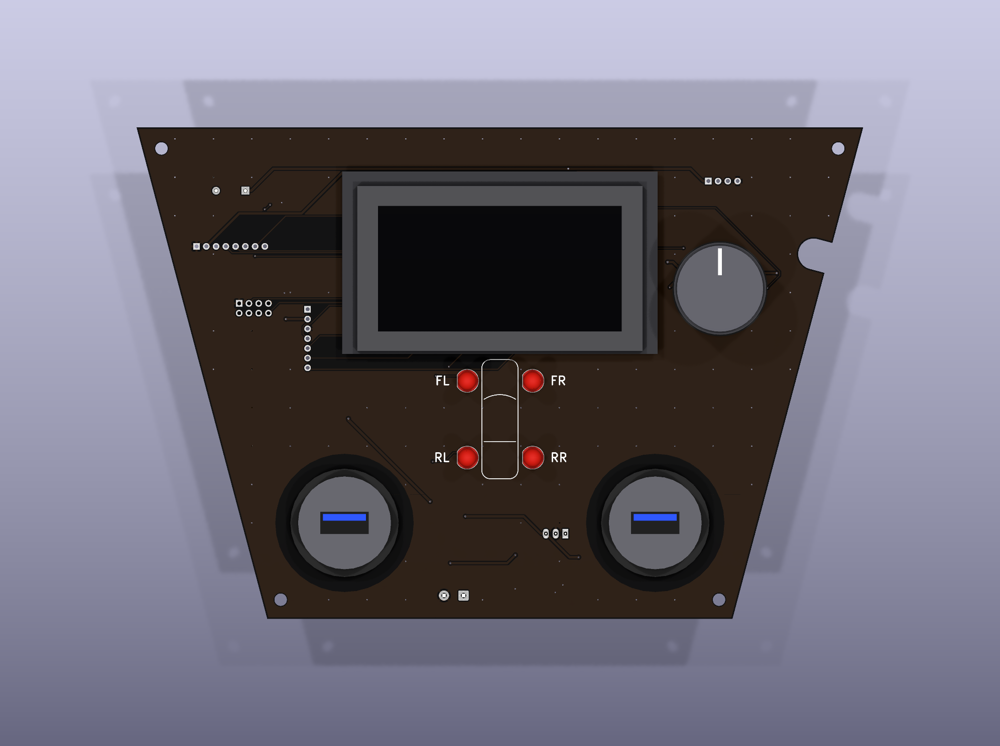

# TPMS monitor panel (2018 Toyota Yaris iA)

A dash panel that receives the car's 315 MHz tyre-pressure (TPMS) sensors and shows the pressures on an OLED display, with four tyre LEDs and a rotary encoder. It is based on my ECE 6723 Embedded Systems project ([report](00-project-management/TPMS_project_report_ECE6723.pdf)).



- **Receiver:** CC1101 module (EBYTE E07-M1101D) on 315 MHz. The report's original MX-05V superregenerative receiver can still be fitted for comparison.
- **MCU:** ESP32 DevKit V1 (DOIT, 30-pin).
- **Display:** Newhaven NHD-2.7-12864WDW3 (128×64 OLED, SSD1322, SPI).
- **Power:** 12 V ACC → protection → 5 V switcher → 3.3 V LDO.

## Interactive 3-D Viewer & Quick Start

```bash
python3 04-viewer/serve_viewer.py    # -> http://127.0.0.1:28776/viewer/
```

## Repository Map

| Folder | Content |
|---|---|
| [00-project-management](00-project-management/README.md) | [PREMORTEM.md](00-project-management/PREMORTEM.md), [TPMS_project_report_ECE6723.pdf](00-project-management/TPMS_project_report_ECE6723.pdf) |
| [01-hardware](01-hardware/README.md) | KiCad 10 project (schematic, PCB, libraries, `scripts/`), [design_audit.md](01-hardware/docs/design_audit.md), `tpms_panel.step`, [1:1 car fit template](01-hardware/docs/tpms_panel_fit_template_1to1.pdf) |
| [02-firmware](02-firmware/README.md) | [bringup/](02-firmware/bringup/README.md) — ESP32 PlatformIO self-test & 315 MHz TPMS receiver decoder |
| [03-manufacturing](03-manufacturing/README.md) | JLCPCB Gerber/drill zip (`production/tpms_panel_gerbers_jlcpcb.zip`) & BOM CSV |
| [04-viewer](04-viewer/README.md) | Offline Three.js r160 Mach-X-template 3-D PCB viewer (`viewer/`), KiCad renders (`renders/`), `make_viewer.py`, `serve_viewer.py` |

> **Sensors:** the Yaris iA's own TPMS is indirect (ABS-based, no wheel sensors). Four GM/Schrader EG53MA4 sensors were added to the tyres, and this panel is their receiver.

> **Status: ready to order.** The outline was accepted from the in-car paper fit (board 1 mm smaller than the opening on the sides and bottom), and the USB holes are Ø25.8 mm for the measured 25.16 mm thread.
> The order file is `03-manufacturing/production/tpms_panel_gerbers_jlcpcb.zip`.
