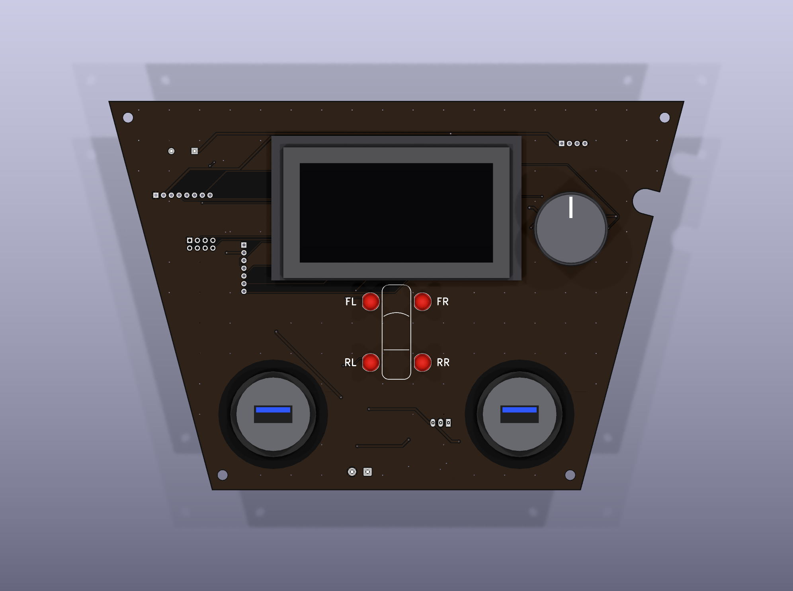

# TPMS monitor panel (2018 Toyota Yaris iA)

A dash panel that receives the car's 315 MHz tyre-pressure (TPMS) sensors and shows the pressures on an OLED display, with four tyre LEDs and a rotary encoder. It is based on my ECE 6723 Embedded Systems project ([report](TPMS_project_report_ECE6723.pdf)).

- **Receiver:** CC1101 module (EBYTE E07-M1101D) on 315 MHz. The report's original MX-05V superregenerative receiver can still be fitted for comparison.
- **MCU:** ESP32 DevKit V1 (DOIT, 30-pin).
- **Display:** Newhaven NHD-2.7-12864WDW3 (128×64 OLED, SSD1322, SPI).
- **Power:** 12 V ACC → protection → 5 V switcher → 3.3 V LDO.

| Path | Content |
|---|---|
| [hardware/](hardware/) | KiCad 10 project (schematic, PCB, libraries), all generated by `hardware/scripts/` |
| [hardware/README.md](hardware/README.md) | Receiver review, MCU choice, pin map, ordering, assembly, firmware notes, how to regenerate |
| [hardware/docs/design_audit.md](hardware/docs/design_audit.md) | Design audit of the schematic, board and Gerbers |
| [hardware/production/](hardware/production/) | JLCPCB Gerber/drill files and the BOM |
| [hardware/docs/tpms_panel_fit_template_1to1.pdf](hardware/docs/tpms_panel_fit_template_1to1.pdf) | 1:1 printable template (US Letter, print at 100 %) to test-fit the panel in the car |
| [firmware/bringup/](firmware/bringup/README.md) | Bring-up self-test and receiver test that decodes the tyre sensors (PlatformIO, ESP32) |
| [docs/premortem.md](docs/premortem.md) | How the project could fail and what has been done about it |

> **Sensors:** the Yaris iA's own TPMS is indirect (ABS-based, no wheel sensors). Four GM/Schrader EG53MA4 sensors were added to the tyres, and this panel is their receiver.

> **Status: ready to order.** The outline was accepted from the in-car paper fit (board 1 mm smaller than the opening on the sides and bottom), and the USB holes are Ø25.8 mm for the measured 25.16 mm thread.
> The order file is `hardware/production/tpms_panel_gerbers_jlcpcb.zip`.
