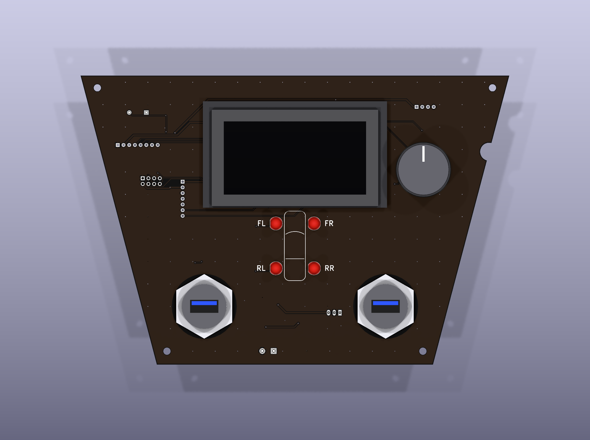
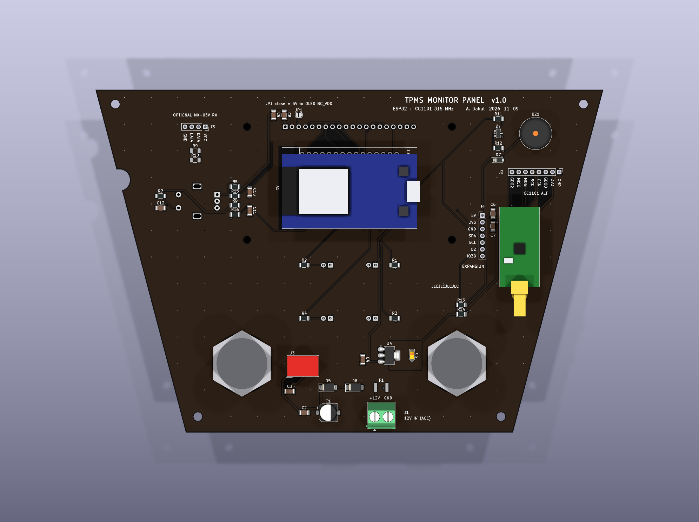

# TPMS Monitor Panel: KiCad project

> **⚠ Not ready to order yet.** The panel outline, notch, USB cut-outs and mounting holes are scaled from the report image.
> **Send the real dimensions before ordering from JLCPCB.** Until then `panel_config.DIMENSIONS_CONFIRMED = False`: every build prints a reminder and names the Gerber zip `tpms_panel_gerbers_jlcpcb_DRAFT_dims_unconfirmed.zip`.
> The latest design audit is in [docs/design_audit.md](docs/design_audit.md).

This is the hardware for the 315 MHz TPMS display described in the project report
([../TPMS_project_report_ECE6723.pdf](../TPMS_project_report_ECE6723.pdf)). The board outline and front
layout follow Figure 3.6 of the report. The whole project is generated by a script, so you can
change the dimensions and rebuild it (see section 7).

| Front (display side) | Back (electronics) |
|---|---|
|  |  |

## 1. Review: will the documented receiver (MX-05V / XY-MK-5V) work?

**The sensor.** The FCC report in your appendix is for the GM/Schrader **EG53MA4** (FCC ID MRXEG53MA4). These are the four sensors installed in the car's tyres; the Yaris iA's own TPMS is indirect and uses no wheel sensors. Key specs:
- 315 MHz ±70 kHz, **ASK/OOK**, Manchester coded.
- Half-bit pulses are about **123 µs**, so roughly 8 kBd on air and ~4 kbit/s of data.
- Each frame lasts 13–28 ms.
- It sends every 30–60 s while the wheels turn, and nothing while the car is parked unless you trigger it with the LF relearn tool.

At 3 m the FCC measured a peak field strength of 78.4 dBµV/m, which is about −49 dBm into an isotropic antenna. Inside a car you can expect roughly −60 to −80 dBm. That is plenty for both receivers, so sensitivity is not the problem. The real limits are listed below.

| | MX-05V superregenerative (documented) | CC1101 module (purchased) |
|---|---|---|
| Modulation | OOK only | OOK/ASK, 2-FSK, GFSK, 4-FSK, MSK. Also covers the FSK sensors used by Toyota, Ford and many aftermarket brands |
| Selectivity | Very wide (MHz-range) front end. Key fobs and any nearby 300–330 MHz traffic get through | Programmable RX filter (e.g. 203 kHz) and a crystal-referenced synthesizer |
| Frequency stability | Tuned by a trimmer coil that drifts with temperature and vibration (car interior: −20…+70 °C) | Crystal accurate (tens of ppm) |
| Idle output | No squelch, so the DATA pin outputs constant noise. The MCU must reject it all the time | Carrier-sense/RSSI available on GDO2, so the MCU can ignore idle noise |
| ~123 µs Manchester | Marginal: these modules are designed for slow (a few kbit/s) remotes, and the LM358 slicer distorts short pulses | Handled easily |
| Supply / logic | 5 V | 3.3 V only (1.8–3.6 V, not 5 V tolerant) |

**Verdict: the MX-05V is not suitable for the in-car panel. Use the CC1101.**
- On the bench it can be a proof of concept with your GM sensors, but only if it is the **315 MHz** version; the 433 MHz one won't hear them.
- In the car, expect missed and corrupted frames, for the reasons in the table above.
- The PCB keeps an optional, unpopulated socket for it (J3, with R9/R10 as a 5 V→3.3 V divider), only for a side-by-side comparison. Leave J3, R9 and R10 empty.

**Your actual module (from the photos): EBYTE E07-M1101D(-SMA) V2.0**
- **Nothing is missing.** The E07 has an 8-pin 2×4 header and all 8 pins are present; pin 1 is the square pad. The green 10-pin CC1101 boards only add a second VCC and GND.
- **The PCB already fits it.** EBYTE's pin table (1 GND, 2 VCC, 3 GDO0, 4 CSN, 5 SCK, 6 MOSI, 7 MISO, 8 GDO2) and size (15 × 30 mm without the SMA) match the U1 footprint, so the PCB needs no change.
- **It is the 433 MHz build.**
  - The silkscreen says "433M" and EBYTE rates the module for 387–464 MHz.
  - The CC1101 chip tunes to 300–348 MHz, so it can receive the 315 MHz sensors. However, the RF matching parts between the chip and the SMA are tuned for 433 MHz, so it loses some sensitivity at 315 MHz (rough estimate: up to ~10 dB).
  - It should still work. The car gives about −60 to −80 dBm (see above), and the CC1101 needs roughly −100 dBm at this data rate (EBYTE quotes −108 dBm at 0.6 kbps).
- **Use a 315 MHz antenna.** An antenna sold with a 433 MHz module is also tuned for 433 MHz. A 315 MHz SMA whip, or for a quick test a ~23 cm wire on the SMA centre pin, recovers part of the loss. Keep the antenna away from metal. An SMA extension cable lets you put it behind plastic trim and keeps its weight off the module's header in a vibrating car.
- **Bring-up checks:**
  1. Continuity from pin 1 to the SMA outer shell should beep (GND).
  2. Over SPI, read the VERSION status register (0x31, sent as 0xF1).
     - 0x14 (current) or 0x04 (legacy) means a TI CC1101.
     - 0x17 or 0x03 means a known clone chip; RadioLib accepts these and they usually work.
     - 0x00 or 0xFF means the wiring/SPI is wrong.
  3. Check that every tyre's frames arrive with an RSSI well above the idle noise floor, and compare against your RTL-SDR running rtl_433.
- **About "TI" and "clone":** TI makes only the chip. The module is EBYTE's own Chinese design, so a Chinese board is expected and does not by itself mean a fake. Check 2 shows whether the chip is genuine.
- **If the rear tyres drop out:**
  - Use a module built for 315 MHz, or re-tune its RF parts to the 315 MHz values in TI's CC1101 reference design.
  - If the replacement's pinout differs from the E07, wire it to the **J2** 1×8 breakout (GND 3V3 GDO0 CSN SCK MOSI MISO GDO2) instead of U1.

## 2. Microcontroller: ESP32 (DOIT ESP32 DEVKIT V1, 30-pin)

| | Arduino Nano | STM32 Blue Pill | **ESP32 DevKit V1** |
|---|---|---|---|
| Logic level | 5 V (needs level shifters for CC1101 and OLED) | 3.3 V | **3.3 V**, matches CC1101 and OLED |
| RAM | 2 KB, which can't even hold the 4 KB 128×64×4-bit OLED frame buffer | 20 KB | **520 KB** |
| CPU | 16 MHz AVR | 72 MHz M3 | **2×240 MHz** (decoding + UI) |
| Wireless | none | none | **Wi-Fi + BLE**: phone app, OTA updates, logging |
| Notes | | clone MCUs common, needs ST-Link | USB bootloader, hardware pulse counter for the encoder, enough GPIO for display, LEDs and expansion |

Both DOIT variants are sold: **0.9 in (22.86 mm)** and **1.0 in (25.4 mm)** row spacing. The footprint provides both GPIO23…3V3 rows. Populate only the row that matches your board.

## 3. Board summary

- **Outline:**
  - Trapezoid, 191 mm wide at the top, 123 mm at the bottom and 129 mm tall.
  - R4 notch on the right edge.
  - Two Ø22 mm cut-outs for panel-mount USB sockets, plus 4× M3 holes. The mounting holes are not in your render; delete them in `panel_config.py` if you don't want them.
  - All of this was scaled from Figure 3.6 using the 82 mm-wide display as the reference.
- **Front:**
  - NHD-2.7-12864WDW3 OLED (SSD1322, 4-wire SPI).
  - 4× 5 mm tyre LEDs centred under the display in a 2×2 "car" layout (FL FR / RL RR) with a car outline on the silkscreen between them.
  - EC11 rotary encoder with push switch to the right of the display: rotate = up/down, push = OK. BACK is a menu entry on the screen and/or a long-press.
  - The original 4-button layout (UP/OK/DOWN/BACK in a column on the right) is still available: set `INPUT_STYLE = "buttons"` in `scripts/panel_config.py` and rebuild.
- **Back:**
  - ESP32 DevKit (on sockets).
  - CC1101 module on the left, with its SMA connector pointing down so the antenna can go straight back into the console pocket.
  - 12 V ACC input: PTC fuse, ±22 V TVS (SMAJ22CA) and SS34 reverse diode, then a TSR 1-2450 5 V switcher, then an AMS1117 3.3 V LDO with a copper heatsink pour (feeds the OLED and radio).
  - Buzzer driver, optional MX-05V socket, optional CC1101 breakout, I²C/GPIO expansion header.
- **PCB:** 2 layers, 1.6 mm, 1 oz copper, GND pour on both sides with stitching vias, tented vias. Rules: 0.25 mm signal / 0.6 mm power tracks, 0.2 mm clearance, 0.6/0.3 mm vias. DRC also enforces JLCPCB's silkscreen limits (text ≥ 1.0 mm high, ≥ 0.15 mm stroke), via ring ≥ 0.15 mm and hole-to-hole ≥ 0.45 mm.
- **Checks (KiCad 10.0.7):**
  - ERC: 0 errors / 0 warnings.
  - DRC: 0 errors / 0 warnings / 0 unconnected.
  - Schematic ↔ PCB parity: 0 issues.
  - The exported Gerber/drill files were also re-read with an independent parser: outline closed (191 × 129 mm), every plated hole has a pad on both layers, no copper on non-plated holes. See [docs/design_audit.md](docs/design_audit.md).

### ESP32 pin map

| GPIO | Net | Connected to |
|---|---|---|
| IO18 / IO23 / IO19 | SPI_SCK / SPI_MOSI / SPI_MISO | CC1101 and OLED (shared VSPI bus; the OLED is write-only) |
| IO5 | CC_CS | CC1101 CSn |
| IO34 | CC_GDO0 | CC1101 GDO0: demodulated OOK data (use an edge interrupt) |
| IO35 | CC_GDO2 | CC1101 GDO2: e.g. carrier sense |
| IO15 / IO27 / IO26 | OLED_CS / OLED_DC / OLED_RES | NHD pins 17 / 4 / 16 |
| IO25 / IO33 / IO32 / IO14 | LED_FL / FR / RL / RR | LEDs through 220 Ω (active high) |
| IO16 / IO17 / IO4 | ENC_A / ENC_B / ENC_SW | Encoder A/B through 10 k pull-up + 10 k / 10 nF RC filter (use the ESP32 PCNT unit or interrupts); push switch with 10 k pull-up + 100 nF (active low) |
| IO13 | BUZZER | MMBT3904 driving a 5 V buzzer (active high) |
| IO36 | MX05_DATA | Optional MX-05V through a 1 k / 10 k divider (its LM358 output reaches only ~3.0–3.7 V, so this gives 2.7–3.4 V) |
| IO21 / IO22 | I2C_SDA / I2C_SCL | J4 expansion, 4.7 k pull-ups |
| IO2 | IO2_EXP | J4 spare. Keep it low or floating at reset so flashing still works |
| IO39 | IO39_EXP | J4 spare, input-only (ADC1), e.g. a fifth button or a light sensor |

IO12 (boot-strapping pin), IO0, TX0/RX0 and EN are deliberately left unused.

## 4. Ordering at JLCPCB

1. Upload the Gerber zip from `production/`. It contains Gerbers, separate PTH/NPTH Excellon drill files and drill maps.
   - While the dimensions are unconfirmed it is named `tpms_panel_gerbers_jlcpcb_DRAFT_dims_unconfirmed.zip`. **Don't order that one.**
   - After the real dimensions are in and `DIMENSIONS_CONFIRMED = True`, the build writes `tpms_panel_gerbers_jlcpcb.zip`.
2. Options:
   - 2 layers, 1.6 mm, 1 oz.
   - **PCB colour: Black, silkscreen: White** (to match the render). ENIG looks nicer on a front panel than HASL.
   - Via covering: Tented.
   - "Remove order number": **Specify a location**. The `JLCJLCJLCJLC` marker is already on the back silkscreen, so the front stays clean.
3. The board is larger than 100×100 mm, so the low-cost promo price doesn't apply.

`production/tpms_panel_bom.csv` lists every part with suggested part numbers. Lines marked "optional" are only needed for the MX-05V test, the alternative CC1101 wiring, or future expansion.

## 5. Assembly notes

1. **Back, SMD first:** 1206 R/C, SOT-223, SMA, SOD-123, SOT-23, 1812 fuse, 6.3 mm electrolytic, and the C5 tantalum (case A). **C5 is polarized:** its banded end is "+" and goes on pad 1, the end closed off by the silkscreen bracket.
2. **Back, through-hole:**
   - TSR 1-2450 (U3). A substitute must also be a 7805-pinout switcher rated for at least 36 V input, e.g. Mornsun K7805-1000R3 (8–36 V). The RECOM R-78E5.0-1.0 is only rated 8–28 V, so don't use it here.
   - J1 screw terminal and the buzzer.
   - The ESP32 sockets: two 1×15 female headers, in the EN…VIN row plus the GPIO23…3V3 row for your board's width.
   - The CC1101 2×4 female socket.
3. **Front:**
   - LEDs: the square pad is the cathode. The 220 Ω resistors give ~6 mA with red, amber or yellow LEDs. Blue or white LEDs (Vf ≈ 3 V) would only get ~1 mA and look dim; use 47–68 Ω for those.
   - Encoder: EC11 with push switch and a 20 mm D-shaft, fitted with a 20–25 mm knob. Solder the two mounting tabs as well; they take the force when the knob is pushed.
   - Display: 1×20 2.54 mm male header with **pin 1 (VSS, square pad) at the right end when looking at the front** (from the NHD rear-view drawing). If you want the display removable, use a female header.
   - Display hardware: the NHD mounting holes are Ø2.5 mm, so use **M2** screws (M2.5 won't pass through) with **M2 × 3 mm** spacers between the display and the PCB.
4. Before fitting the display, trim the ESP32 socket pins that come through to the front **to ≤ 1 mm**, because they sit under the display.
   - The display's own back carries parts up to ~2.1 mm tall (bezel tabs, FPC connector), and its flex cable runs over the lower socket row.
   - With 3 mm spacers this leaves about 0.9 mm of clearance.
5. The CC1101 module plugs in components-up (facing away from the PCB) with its SMA pointing **down**.
   - In the car, the panel's top edge sits directly under the HVAC controls, so nothing can leave through it. That's why the module was moved off the top-left corner.
   - Fit a **90° SMA adapter** (male–female) on the module and point the 315 MHz antenna straight back into the console pocket.
   - Or use an SMA extension cable (RG316/RG174, 0.3–1 m) to put the antenna somewhere better; see the antenna notes in section 8.
   - The ESP32's micro-USB plug points left toward J2. It has about 60 mm of free run, or about 35 mm if J2 is fitted. A short-bodied or 90° micro-USB cable helps, or flash over Wi-Fi (OTA) once the first firmware is in.
6. **JP1 stays open.** Close it only if you rework the NHD module to jumper option #1 (R4 open, R5 closed) so its OLED boost converter runs from 5 V.
   - At full brightness the OLED draws up to 345 mA (375 mA max) from the 3.3 V LDO, about 0.65 W of heat in U4. The board has a copper pour on U4's tab for this.
   - With option #1, the boost draws ~200 mA from 5 V instead and U4 stays cool. Consider it if the panel will sit in a hot dashboard with a mostly-lit screen.
7. Power:
   - Connect switched **12 V ACC** to J1 (expected draw < 0.5 A).
   - Tap ACC through an **add-a-fuse (1–2 A)** at the fuse box. The on-board PTC protects the board, not the wire.
   - **Never wire it to constant 12 V.** The panel draws about 1 W, which flattens a car battery in roughly two weeks.
   - On the bench, the ESP32's USB alone powers everything. A laptop port (500 mA) can brown out when the screen is bright and Wi-Fi is on, so use a powered hub or a 12 V supply if it resets.
   - Most DevKits have a VBUS diode, so 12 V and USB can be connected together. If yours doesn't, use one or the other.
8. The panel-mount USB sockets are not wired to the board. Measure your sockets and adjust `USB_HOLE_DIAMETER` before ordering. If they should charge phones, feed them from a separate 12 V → 5 V/3 A car USB charger module; U3 can't power them.
9. **First power-up:**
   - Before plugging in the DevKit, CC1101 and display, power the bare board and measure 5 V and 3V3 on the J4 pads.
   - The CC1101's 2×4 header and the DevKit are symmetric, so a module rotated 180° gets reversed power. Check the "1"/"SMA" and "USB"/"ANTENNA" silkscreen first.
   - Then flash the [bring-up firmware](../firmware/bringup/README.md); its self-test checks every part.
10. **For the car (vibration):**
    - Use machined round-pin gold sockets for the DevKit, or solder it in.
    - Put a dab of RTV on the socketed modules.
    - Don't hang a heavy antenna on the module. Use a short stubby antenna on the 90° adapter, or an extension cable with the antenna fixed to the console.
    - Crimp ferrules on the J1 wires.

## 6. Firmware starting points

> The Yaris iA's own TPMS is indirect (ABS wheel speeds, no wheel sensors). The four GM/Schrader EG53MA4 sensors you had installed feed only this panel, so the settings below are the ones to use.
> The [bring-up firmware](../firmware/bringup/README.md) already uses them and decodes the sensors (ID, pressure, temperature). Risks and next steps are in [docs/premortem.md](../docs/premortem.md).

### CC1101 settings for the GM/Schrader EG53MA4

These values are calculated from the CC1101 datasheet formulas for a 26 MHz crystal. Treat them as a starting point and check them in TI SmartRF Studio, which also gives the ASK/OOK AGC settings. The bring-up firmware's OOK profile uses the same settings with a 16 kBd demodulator filter.

| Register | Value | Meaning |
|---|---|---|
| FREQ2/1/0 | 0x0C / 0x1D / 0x8A | 315.000 MHz (793 994 × 26 MHz / 2¹⁶) |
| MDMCFG4 / MDMCFG3 | 0x88 / 0x4B | RX bandwidth 203 kHz, data rate ≈ 8.2 kBd |
| MDMCFG2 | 0x30 | ASK/OOK, no sync word |
| PKTCTRL0 | 0x32 | Asynchronous serial mode |
| IOCFG0 / IOCFG2 | 0x0D / 0x0E | GDO0 = serial data out (to IO34), GDO2 = carrier sense (to IO35) |

How to decode:
1. Timestamp every edge on IO34.
2. Manchester-decode with a half-bit of about 123 µs.
3. Parse the frame as rtl_433's `schrader_EG53MA4` decoder does (`src/devices/schraeder.c`): a 120-bit frame with a 24-bit ID, pressure byte × 25 mbar, temperature byte in °F, and an additive checksum.
4. Trigger each wheel with the OEC-T5 tool to learn which ID belongs to FL/FR/RL/RR.

Libraries such as SmartRC-CC1101-Driver-Lib or RadioLib work on the ESP32.

315 MHz needs band-specific settings besides FREQ:
- TEST0 must be 0x0B below ~323 MHz, versus 0x09 at 433 MHz.
- SmartRC's `setMHZ(315.0)` sets TEST0 and FSCTRL0 for you.
- If you write the registers yourself, export the 315 MHz set from SmartRF Studio. Don't reuse a 433 MHz register dump with only FREQ changed.

Encoder: count A/B with the ESP32 PCNT peripheral (e.g. the ESP32Encoder library); an EC11 gives 4 counts per detent, so divide by 4 for one menu step per click. Use a short press for OK and a long press (~0.6 s) for BACK.

Things to watch in firmware:
- **GDO0 clock at power-up:** until IOCFG0 is written, the CC1101 outputs a 135 kHz clock on GDO0 (its reset default, CLK_XOSC/192). Configure the radio first, then attach the IO34 edge interrupt; otherwise the interrupt floods the CPU.
- **Shared SPI bus:** the CC1101 and the OLED share SCK/MOSI. Keep the CC1101 transactions at ≤ 6.5 MHz (its burst-access limit) and the SSD1322 at ≤ 10 MHz. The CC1101 releases MISO when CSn is high, as long as IOCFG1 stays at its default (0x2E, high impedance).
- **Power loss:** ACC power can drop at any moment. Save learned sensor IDs with NVS (Preferences), and only when they change.
- **Input-only pins:** IO34/35/36/39 have no internal pull-ups. IO36 floats when the optional MX-05V parts are not fitted, so don't enable an interrupt on it then.

## 7. Changing dimensions / regenerating

Everything is generated from three files in `scripts/`:
- `panel_config.py`: outline, front-panel positions (LEDs, encoder or buttons via `INPUT_STYLE`), hole sizes and component placement.
- `design.py`: the circuit (parts, nets, schematic layout).
- `build_tpms_panel.py`: the generator.

Requirements:
- KiCad 10. The build uses `kicad-cli` and the Python that ships with KiCad.
- Java 21 or newer.
- Freerouting 2.5 jar. Set the `FREEROUTING_JAR` environment variable if it isn't in `%LOCALAPPDATA%\Programs\freerouting`.

```powershell
& "$env:LOCALAPPDATA\Programs\KiCad10\bin\python.exe" hardware\scripts\build_tpms_panel.py
#   --no-route   placement only      --no-render  skip 3D renders / STEP
#   --template-only   just rewrite the 1:1 fit template PDF from the current board
```

One run (about 1.5–2 minutes) does all of the following:
- rebuilds the libraries, schematic and project;
- runs ERC;
- places, autoroutes, pours and stitches the board. Freerouting sometimes stalls with one or two connections left, so the script retries with a reshuffled routing order and keeps the best result;
- runs DRC with schematic parity. If any DRC error remains, the script exits with code 2 and prints "do NOT order these Gerbers";
- exports Gerbers, drill files, the zip, BOM, PDFs, renders, the STEP model and the 1:1 fit template.

**Hand edits to `tpms_panel.kicad_pcb` are overwritten** on the next run. Once the dimensions are final you can stop using the script and continue in KiCad.

## 8. Before ordering: checklist

1. **Test-fit a paper copy.** Print [docs/tpms_panel_fit_template_1to1.pdf](docs/tpms_panel_fit_template_1to1.pdf) on US Letter at **100 % / Actual size** (not "Fit to page").
   - Check the 100 mm and 4 in bars with a ruler before trusting the print.
   - Cut it out and hold it in the dash.
   - Page 1 shows the front parts and the depth of the parts behind the panel; page 2 is the plain outline for tracing onto cardboard.
2. **Send me the real measurements.** The outline and holes are currently scaled from the report image (about ±1–2 mm). I'll then update `panel_config.py`, set `DIMENSIONS_CONFIRMED = True` and rebuild, which also regenerates the template. Measure in the console opening under the HVAC controls (see "In-car fit" below):
   - **Width** across the top, just under the lowest point of the HVAC knob rings, and across the bottom where the panel's bottom edge will sit.
   - **Height** from the lowest point of the HVAC bezel to the pocket's lower lip, and the angle of the sides (or the width halfway down).
   - **The notch** on the right edge: does it clear something in the car? If not, it can go.
   - **Depth behind the panel:** from the opening face to the strip with the 12 V socket / USB / AUX (top 30–40 mm of the panel), and to the pocket's back wall lower down. The ESP32 needs about 16 mm and the radio about 16 mm. The antenna on its 90° adapter points straight back from the radio, so it needs about 25 mm plus its own length; with no room for that, use an extension cable.
   - **Shifter clearance:** with the shifter in P, the gap from the shift knob to the panel face at the right USB socket.
   - **How it will be held:** where screws or brackets can go. The four M3 holes are placeholders and can move.
3. Measure the panel-mount USB sockets: the thread/hole diameter and the nut or flange diameter. Ø22 mm holes and a 29 mm nut keep-out are assumed.
4. Confirm your ESP32 board is a DOIT 30-pin with an ESP32-WROOM-32 (not WROVER), and whether its rows are 0.9 in or 1.0 in apart. Both widths fit; a 38-pin DevKitC needs a different footprint.
5. After the rebuild, check that the build output says DRC 0 errors / 0 warnings and that the zip name no longer contains `DRAFT`.
6. Buy the parts the audit changed: C1 47 µF/50 V (EEE-FK1H470XP), C5 22 µF tantalum case A, D6 SMAJ22CA, R9 1 k. Also buy a 90° SMA adapter (male–female) and a 315 MHz antenna: a short stubby, or a whip on an SMA extension cable.

### In-car fit (review of the 2026-11-09 template photos)

- **Outline:** the printed template matches the console opening under the HVAC controls. The slanted sides follow the carbon-look trims, the top edge sits under the HVAC bezel, and the bottom clears the pocket lip. Only the exact numbers above are still needed.
- **The panel covers the car's 12 V socket, USB, AUX and card slot** (the strip at the top of the pocket). Options:
  - Wire one front USB socket as a panel-mount extension of the car's USB port.
  - Plug a 12 V → USB charger into the 12 V socket for the other front USB socket.
  - Power the panel from the 12 V socket (it should be ACC-switched; check that it reads 0 V with the key off), through a right-angle 12 V plug or a fused tap of its wiring.
- **Antenna:** the old top-left position pointed the SMA connector straight into the HVAC unit, so no antenna or cable could be attached. The radio now sits mid-left with the SMA pointing down; a 90° adapter sends the antenna straight back into the pocket.
  - The console trim is plastic (the carbon look is only a finish), so it doesn't block 315 MHz.
  - Start with a short 315 MHz antenna on the adapter and check each wheel's signal strength with the [bring-up firmware](../firmware/bringup/README.md).
  - If a rear wheel is weaker than about −95 dBm, move the antenna out of the pocket on an extension cable, e.g. up behind the dash or along the console side under plastic. Keep it away from the steel floor tunnel and from the USB socket bodies.
- **Shifter:** in P, the shift knob sits in front of the lower-right part of the panel. A cable plugged into the **right** USB socket may hit it.
  - Check the gap; use a 90° USB cable, or I can move that socket up and left.
  - The display, LEDs and knob stay clear of the shifter.

Already confirmed:
- CC1101 module: an EBYTE E07-M1101D (from your photos). Its pinout and 15 × 30 mm size match U1. It is the 433 MHz build, so expect somewhat lower sensitivity at 315 MHz (see section 1).
- NHD-2.7-12864WDW3: pinout, pin-1 side, header position and hole pattern checked against the current Newhaven datasheet.

## Files

| Path | Content |
|---|---|
| `tpms_panel.kicad_pro / .kicad_sch / .kicad_pcb` | KiCad 10 project |
| `lib/` | Custom symbols (`TPMS.kicad_sym`), footprints (`TPMS.pretty`) and simple 3D models |
| `production/` | Gerber zip for JLCPCB, Gerber/drill folder, BOM |
| `docs/` | Schematic PDF, front-layer PDF, renders, STEP model, 1:1 printable fit template, design audit (`design_audit.md`) |
| `build/` | Intermediate files: netlist, DSN/SES, Freerouting log, ERC/DRC reports (created by the build; not in git) |
